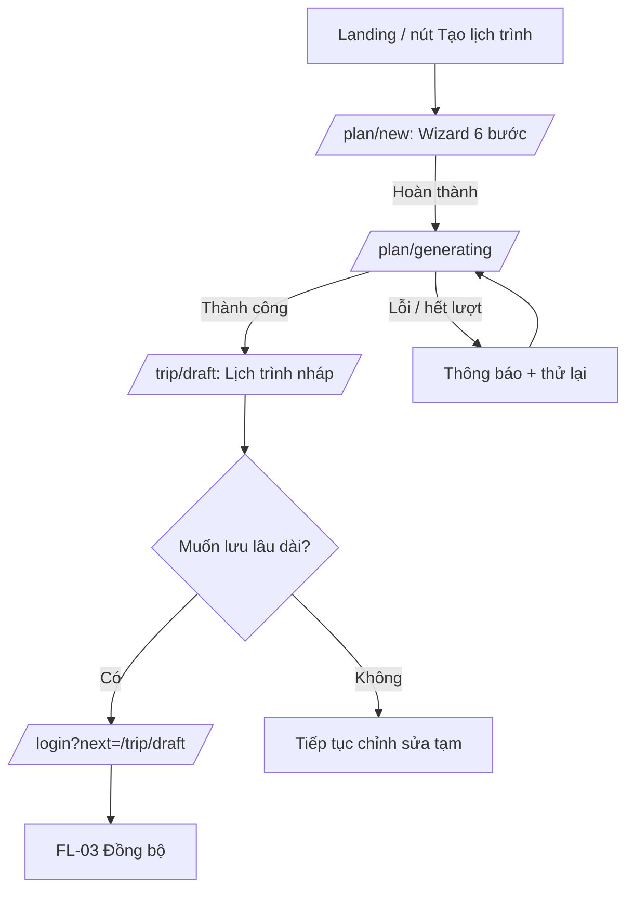
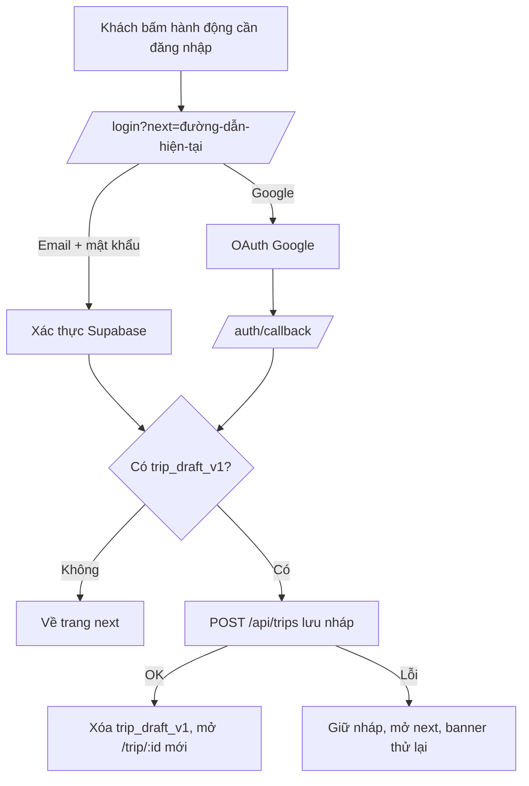
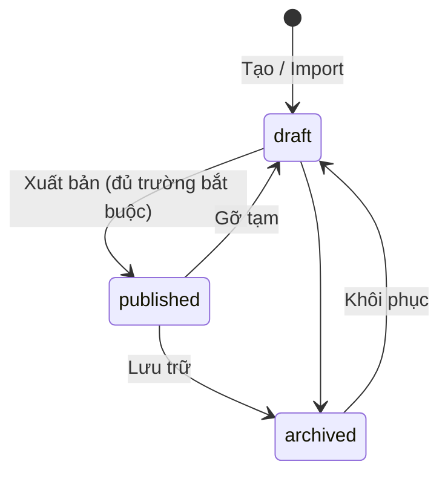

# 03 — User Flows

> Mô tả các luồng người dùng từng bước, kèm nhánh lỗi và trường hợp đặc biệt. Dùng khi làm UI, điều hướng, quản lý state.
> Tính năng chi tiết: `docs/02-features.md` · Route: `docs/04-routes-and-pages.md` · Dữ liệu: `docs/05-data-model.md`.

## Quy ước

- **Mã luồng:** `FL-xx`.
- Ký hiệu: `[Trang]` = một màn hình, `{Hành động}` = thao tác của người dùng, `(Hệ thống)` = xử lý tự động.
- Hai khóa lưu tạm trên trình duyệt (localStorage), dùng đúng tên này trong toàn dự án:

| Khóa | Nội dung | Khi nào xóa |
|---|---|---|
| `wizard_draft_v1` | Dữ liệu wizard đang nhập dở (kèm bước hiện tại) | Sau khi sinh lịch trình thành công, hoặc người dùng chọn "Làm lại từ đầu" |
| `trip_draft_v1` | Lịch trình nháp của khách chưa đăng nhập (toàn bộ ngày + mục) | Sau khi đồng bộ lên tài khoản thành công, hoặc người dùng xóa |

- Hậu tố `_v1` để sau này đổi cấu trúc thì bỏ qua dữ liệu cũ an toàn.
- Khi đọc từ localStorage luôn **kiểm tra bằng Zod**; dữ liệu hỏng thì bỏ đi, không làm sập trang.

---

## FL-01 — Khách tạo lịch trình (luồng chính)

**Tác nhân:** Khách chưa đăng nhập · **Điểm vào:** `/`, `/explore`, hoặc bất kỳ nút "Tạo lịch trình"

**Các bước**

1. `[Landing]` Khách bấm **"Tạo lịch trình"**.
2. `[/plan/new]` (Hệ thống) đọc `wizard_draft_v1`. Nếu có dữ liệu dở dang, hiện hộp nhỏ: **"Tiếp tục" / "Làm lại từ đầu"**.
3. Khách đi qua 6 bước: Thời gian → Người đi → Sở thích → Phong cách → Xuất phát → Xác nhận.
   - Mỗi lần sang bước mới, (Hệ thống) kiểm tra dữ liệu bước hiện tại bằng Zod; sai thì hiện lỗi cụ thể và không cho đi tiếp.
   - Mỗi thay đổi đều ghi vào `wizard_draft_v1`.
   - Bấm "Quay lại" không làm mất dữ liệu.
4. `[Bước 6: Xác nhận]` Khách xem tóm tắt, có thể bấm vào từng mục để sửa (nhảy về đúng bước), rồi bấm **"Tạo lịch trình"**.
5. `[/plan/generating]` (Hệ thống) gọi `POST /api/trips/generate` với dữ liệu wizard.
   - Hiển thị tiến trình theo giai đoạn: "Đang chọn địa điểm hợp gu bạn" → "Đang sắp xếp theo ngày" → "Đang viết lý do gợi ý". Đây là chỉ báo giao diện, không cần khớp tiến độ thật.
   - Có nút **"Hủy"** (hủy request, quay về bước 6 giữ nguyên dữ liệu).
6. (Hệ thống) nhận lịch trình nháp, kiểm tra bằng Zod, ghi vào `trip_draft_v1`, xóa `wizard_draft_v1`.
7. `[/trip/draft]` Hiển thị lịch trình. Một dải mời nhẹ: **"Đăng nhập để lưu lịch trình và chia sẻ cho bạn bè"**.

**Nhánh lỗi**

| Tình huống | Xử lý |
|---|---|
| Mất mạng khi đang sinh | Hiện lỗi "Không kết nối được", nút "Thử lại"; dữ liệu wizard giữ nguyên |
| LLM lỗi/timeout | Server tự dùng fallback; client nhận kết quả bình thường, có thể kèm lưu ý nhẹ ("Lịch trình được tạo theo cách đơn giản hơn") |
| Chạm giới hạn tần suất (429) | Hiện "Bạn tạo lịch trình hơi nhanh. Thử lại sau X giây" kèm nút quay về; khuyến khích đăng nhập nếu đang là khách |
| Không đủ địa điểm phù hợp | Vẫn tạo lịch trình ít điểm hơn, hiện thông báo giải thích và gợi ý đổi sở thích/nhịp độ |
| Phản hồi không hợp lệ | Hiện lỗi chung, giữ nguyên wizard, cho thử lại; ghi log phía server |
| localStorage không dùng được (chế độ riêng tư chặn) | Giữ dữ liệu trong bộ nhớ trang; cảnh báo "Tải lại trang sẽ mất lịch trình" |

---

## FL-02 — Người dùng đã đăng nhập tạo lịch trình

**Tác nhân:** User · **Khác FL-01 ở bước lưu**

1. Bước 1–5 giống FL-01 (gửi kèm token đăng nhập để áp dụng hạn mức của user).
2. (Hệ thống) sau khi nhận lịch trình nháp, client gọi `POST /api/trips` để **lưu ngay** thành `trips` + `trip_days` + `trip_items`.
3. Chuyển sang `[/trip/:id]` (thay thế lịch sử, để nút Back không quay lại màn hình chờ).
4. Hiển thị toast "Đã lưu vào Chuyến đi của tôi".

**Nhánh lỗi**
- Sinh được nhưng **lưu thất bại**: giữ lịch trình trong `trip_draft_v1`, mở `/trip/draft` kèm banner "Chưa lưu được, thử lại" và nút **"Lưu lại"**. Không được làm mất lịch trình vừa sinh.

---

## FL-03 — Đăng nhập và đồng bộ chuyến đi tạm

**Tác nhân:** Khách → User · **Điểm vào:** lời mời đăng nhập ở nhiều nơi (lưu chuyến đi, lưu địa điểm, chia sẻ)

**Các bước**

1. Khách bấm hành động cần quyền (Lưu chuyến đi, Lưu địa điểm, Chia sẻ...).
2. (Hệ thống) chuyển đến `/login?next=<đường dẫn hiện tại>`; nếu hành động là "lưu địa điểm", ghi nhớ địa điểm đó (`pending_action`) để thực hiện sau khi đăng nhập.
3. Khách đăng nhập hoặc đăng ký (email + mật khẩu hoặc Google).
   - Đăng ký email: nếu bật xác nhận email, hiện màn hình "Hãy kiểm tra email để xác nhận", và khi xác nhận xong quay lại `next`.
4. (Hệ thống) sau khi có phiên đăng nhập:
   - Tự tạo `profiles` (trigger ở DB).
   - Nếu có `trip_draft_v1`: gọi `POST /api/trips` để lưu, thành công thì xóa nháp và mở `/trip/:id`.
   - Nếu có `pending_action`: thực hiện (ví dụ lưu địa điểm) rồi xóa.
   - Nếu không có gì: chuyển đến `next` (mặc định `/account/trips`).
5. Toast xác nhận: "Đã đăng nhập" (và "Đã lưu lịch trình của bạn" nếu có đồng bộ).

**Quy tắc**
- `next` chỉ chấp nhận đường dẫn nội bộ (bắt đầu bằng `/`, không phải `//` hay URL đầy đủ) để tránh chuyển hướng độc hại.
- Đồng bộ phải **idempotent**: nếu bị gọi hai lần (tải lại, mạng chập chờn) không được tạo hai chuyến đi giống nhau. Dùng `client_draft_id` (UUID sinh khi tạo nháp) làm khóa chống trùng.

**Nhánh lỗi**

| Tình huống | Xử lý |
|---|---|
| Sai email/mật khẩu | "Email hoặc mật khẩu chưa đúng" (không tiết lộ email có tồn tại hay không) |
| Email đã đăng ký | Gợi ý chuyển sang đăng nhập |
| Hủy/đóng cửa sổ Google | Quay về `/login`, không báo lỗi nặng |
| Phiên hết hạn khi đang dùng | Làm mới token tự động; không được thì chuyển đến `/login?next=...` và **giữ dữ liệu đang sửa** nếu có thể |
| Quên mật khẩu | Gửi email đặt lại → `/reset-password` → đăng nhập |

---

## FL-04 — Xem và chỉnh sửa lịch trình

**Tác nhân:** Khách (nháp) / User (chủ sở hữu) · **Trang:** `/trip/draft` hoặc `/trip/:id`

### 4.1 Xem lịch trình
1. Mở trang: tải chuyến đi (từ server hoặc `trip_draft_v1`).
2. Mặc định hiển thị **Ngày 1**; chuyển ngày bằng tab (mobile: cuộn ngang) hoặc phím mũi tên trên desktop.
3. Danh sách theo khung giờ + bản đồ ngày đang chọn. Chọn một mục thì bản đồ tập trung vào điểm đó và ngược lại.
4. Bấm vào tên địa điểm mở **ngăn xem nhanh** (bottom sheet/side panel) với liên kết sang `/place/:slug`.

### 4.2 Đổi thứ tự / chuyển ngày
1. Kéo thả một mục (desktop) hoặc bấm "Lên/Xuống/Chuyển ngày..." (mobile).
2. (Hệ thống) tính lại giờ dự kiến và thời gian di chuyển của ngày bị ảnh hưởng.
3. (Hệ thống) chạy kiểm tra cảnh báo (giờ mở cửa, quá xa, quá nhiều điểm); nếu có, hiện **huy hiệu cảnh báo** ở mục liên quan, **không chặn**.
4. Lưu tự động (User) / ghi vào `trip_draft_v1` (Khách). Chỉ báo "Đang lưu… / Đã lưu".

### 4.3 Xóa một điểm
1. Bấm biểu tượng xóa → xóa ngay, hiện toast **"Đã xóa X · Hoàn tác"** (5 giây).
2. Hoàn tác khôi phục đúng vị trí cũ.

### 4.4 Thay thế một điểm
1. Bấm "Thay thế" ở một mục → mở bottom sheet **"Gợi ý thay thế"**.
2. (Hệ thống) gọi `POST /api/trips/alternatives` (dùng được cho cả khách lẫn user, không phụ thuộc chuyến đi đã lưu) để lấy 3–5 địa điểm cùng loại/tag, gần vị trí, **không trùng** với địa điểm đã có trong chuyến đi, phù hợp giờ mở cửa.
3. Khách chọn một phương án → thay vào đúng vị trí, tính lại thời gian di chuyển; có hoàn tác.
4. Không có phương án phù hợp: hiện "Chưa có gợi ý thay thế" kèm nút **"Tìm trong danh sách"** (mở 4.5).

### 4.5 Thêm một địa điểm
1. Bấm **"+ Thêm địa điểm"** trong ngày → mở bottom sheet tìm kiếm (ô tìm + lọc loại).
2. Chọn một địa điểm → chọn khung giờ (mặc định khung còn trống gần nhất) → thêm vào cuối khung đó.
3. Địa điểm đã có trong chuyến đi hiển thị trạng thái "Đã thêm" và không chọn được lần nữa.
4. Thêm từ trang khác: ở `/place/:slug` bấm **"Thêm vào chuyến đi"** → chọn chuyến đi (User) hoặc dùng nháp hiện tại (Khách) → chọn ngày → xong.

### 4.6 Tạo lại một ngày
1. Bấm "Tạo lại ngày này" → hộp thoại: có thể **khóa** (giữ) một số điểm bằng biểu tượng ổ khóa.
2. (Hệ thống) gọi `POST /api/trips/regenerate-day` với các điểm bị khóa và danh sách địa điểm đã dùng ở các ngày khác (để không trùng).
3. Kết quả thay thế nội dung ngày đó; các ngày khác không đổi. Có hoàn tác toàn bộ thao tác.
4. Lỗi/hết lượt: giữ nguyên ngày cũ, hiện thông báo.

### 4.7 Sửa tiêu đề, giờ, ghi chú
- Tiêu đề: bấm vào để sửa tại chỗ.
- Giờ bắt đầu và thời lượng của từng mục: chọn từ bộ chọn giờ; (Hệ thống) cảnh báo nếu chồng giờ.
- Ghi chú: ô văn bản tối đa 300 ký tự.

**Quy tắc chung của FL-04**
- Mọi thao tác ghi: cập nhật giao diện **lạc quan (optimistic)**, nếu lưu lỗi thì hoàn lại và hiện toast lỗi.
- Gộp (debounce) các lưu liên tiếp, tối đa một yêu cầu mỗi ~800 ms.
- Khi hai tab cùng sửa một chuyến đi: bản ghi sau thắng (last-write-wins); dùng `updated_at` để phát hiện và hiện cảnh báo "Lịch trình đã thay đổi ở nơi khác. Tải lại?".

---

## FL-05 — Chia sẻ và xem lịch trình được chia sẻ

### 5.1 Chủ chuyến đi chia sẻ
1. `[/trip/:id]` bấm **"Chia sẻ"**. (Khách: được mời đăng nhập theo FL-03.)
2. Bật công tắc **"Cho phép ai có link xem"** → (Hệ thống) tạo `share_token`, hiển thị link `/s/<token>`.
3. Bấm **"Sao chép link"** (toast "Đã sao chép") hoặc hộp chia sẻ của thiết bị trên mobile.
4. Tắt công tắc → link cũ **vô hiệu ngay**. Bật lại → token **mới**.

### 5.2 Người nhận xem
1. Mở `/s/<token>` (không cần đăng nhập). (Hệ thống) gọi `GET /api/shared/:token`.
2. Hiển thị bản **chỉ đọc**: tiêu đề, các ngày, bản đồ, lý do gợi ý. Không hiển thị thông tin cá nhân của chủ chuyến đi.
3. Nút **"Tạo bản sao của tôi"**:
   - Khách: chuyển đến đăng nhập với `next=/s/<token>?copy=1`; sau đăng nhập tự thực hiện sao chép.
   - User: gọi `POST /api/shared/:token/copy` → mở `/trip/:id` mới của người đó.
4. Token sai hoặc đã tắt chia sẻ: trang "Lịch trình không còn được chia sẻ" kèm nút "Tạo lịch trình của riêng bạn".

---

## FL-06 — Khám phá, lưu địa điểm, thêm vào chuyến đi

1. `[/explore]` Khách lọc theo loại/tag, tìm kiếm. URL cập nhật theo bộ lọc.
2. Bấm thẻ → `[/place/:slug]` xem chi tiết.
3. Bấm **trái tim**:
   - User: lưu ngay (optimistic), toast "Đã lưu". Bấm lại để bỏ lưu.
   - Khách: mở hộp **"Đăng nhập để lưu địa điểm"** → FL-03 (kèm `pending_action = save_place:<id>`).
4. Bấm **"Thêm vào chuyến đi"** → theo mục 4.5.
5. `[/account/saved]` xem danh sách đã lưu; từ đây có thể "Thêm vào chuyến đi".

**Nhánh đặc biệt:** địa điểm đã lưu nhưng sau đó bị admin gỡ (status ≠ published) → biến mất khỏi danh sách, không báo lỗi.

---

## FL-07 — Quản lý "Chuyến đi của tôi"

1. `[/account/trips]` hiển thị danh sách (mới cập nhật nhất lên đầu).
2. Mỗi thẻ có menu: **Mở · Đổi tên · Nhân bản · Chia sẻ · Xóa**.
3. **Xóa:** hộp thoại xác nhận nêu rõ tên chuyến đi và việc không thể khôi phục → xóa → toast.
4. **Nhân bản:** tạo bản sao tên "<Tên> (bản sao)", không kế thừa `share_token`, mở trang chuyến đi mới.
5. Trạng thái rỗng: minh họa + nút **"Tạo chuyến đi đầu tiên"**.
6. **Cài đặt tài khoản** (`/account/settings`): sửa tên hiển thị, **xóa tài khoản** (xác nhận hai bước; xóa toàn bộ chuyến đi và địa điểm đã lưu).

---

## FL-08 — Quản trị viên nhập và duyệt dữ liệu

**Tác nhân:** Admin

### 8.1 Thêm/sửa một địa điểm
1. `[/admin/places]` → **"Thêm địa điểm"** hoặc chọn một dòng để sửa.
2. Form chia nhóm: Thông tin cơ bản · Vị trí (ghim bản đồ hoặc nhập lat/lng) · Giờ giấc & chi phí · Phân loại & tag · Ảnh (bắt buộc ghi công + giấy phép) · Trạng thái.
3. **Lưu nháp** (`draft`) hoặc **Xuất bản** (`published`). Thiếu trường bắt buộc để xuất bản (tên, loại, lat/lng, mô tả ngắn, ảnh bìa, `visit_duration_min`) thì chặn và liệt kê trường thiếu.
4. **Duyệt** (`verified`) là thao tác riêng, ghi lại người duyệt và thời điểm.

### 8.2 Import CSV
1. `[/admin/import]` tải lên file CSV (theo mẫu có thể tải về).
2. (Hệ thống) phân tích và kiểm tra từng dòng → hiển thị **bảng xem trước**: dòng hợp lệ (xanh), có cảnh báo (vàng), lỗi (đỏ) kèm lý do.
3. Admin chọn **"Import các dòng hợp lệ"** → (Hệ thống) upsert theo `slug`, đặt `status = draft`, `verified = false`.
4. Hiển thị báo cáo: số dòng tạo mới / cập nhật / bỏ qua / lỗi; tải được file CSV các dòng lỗi.
5. Admin vào danh sách lọc "Nháp" để rà soát, bổ sung ảnh, duyệt và xuất bản.

### 8.3 Vòng đời một địa điểm

- `verified` độc lập với `status`: một địa điểm có thể `published` nhưng chưa `verified`.
- **Không xóa cứng** địa điểm đã nằm trong chuyến đi của người dùng; chuyển sang `archived`. Chuyến đi cũ vẫn hiển thị địa điểm đó với nhãn "Không còn trong hệ thống" (không gây lỗi).

---

## FL-09 — Các trường hợp chung

| Tình huống | Hành vi mong đợi |
|---|---|
| Mất mạng khi đang dùng | Banner "Bạn đang offline"; chỉnh sửa tiếp tục ghi cục bộ và **tự đồng bộ khi có mạng** (User); khách thao tác trên nháp cục bộ |
| API trả 401 | Thử làm mới token một lần; vẫn lỗi thì chuyển `/login?next=...` |
| API trả 403 | Trang "Bạn không có quyền truy cập" |
| API trả 404 (trip) | Trang "Không tìm thấy lịch trình" kèm nút về `/account/trips` |
| API trả 429 | Thông báo giới hạn tần suất kèm thời gian chờ |
| API trả 5xx | Thông báo lỗi chung, nút "Thử lại", không lộ chi tiết kỹ thuật |
| Lỗi render bất ngờ | Error boundary hiển thị trang lỗi thân thiện, có nút "Về trang chủ" |
| `/trip/draft` khi không có nháp | Chuyển đến `/plan/new` kèm thông báo "Chưa có lịch trình nào" |
| `/plan/generating` khi không có `wizard_draft_v1` | Chuyển đến `/plan/new` |
| Truy cập trang cần đăng nhập khi chưa đăng nhập | Chuyển `/login?next=...` |
| Người dùng đã đăng nhập vào `/login` | Chuyển đến `next` hoặc `/account/trips` |

---

## Ma trận luồng và tính năng

| Luồng | Tính năng liên quan |
|---|---|
| FL-01, FL-02 | F-01, F-05, F-06, F-07 |
| FL-03 | F-08, F-09 |
| FL-04 | F-07, F-03, F-04 |
| FL-05 | F-11 |
| FL-06 | F-02, F-03, F-10 |
| FL-07 | F-09, F-08 |
| FL-08 | F-12 |
| FL-09 | F-14 |

## Câu hỏi còn mở

- [ ] Giới hạn số chuyến đi mỗi user (ví dụ 20) để tránh lạm dụng?
- [ ] Có cho hoàn tác nhiều bước (undo stack) hay chỉ 1 bước ở MVP? (hiện ghi: tối thiểu 1 bước)
- [ ] Đăng ký email có bắt buộc xác nhận email trước khi dùng không?
