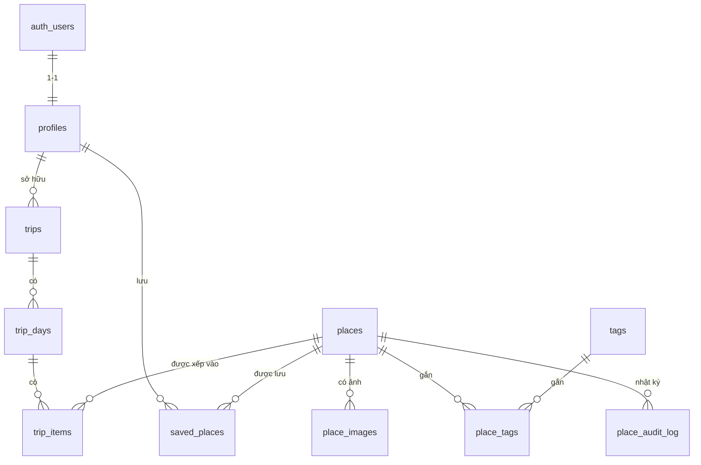

# 05 — Data Model (Supabase / Postgres)

> Cấu trúc bảng, quan hệ, ràng buộc, RLS, trigger, Storage và định dạng CSV import.
> Mọi thay đổi cấu trúc phải đi qua **migration mới** trong `supabase/migrations/`, không sửa migration đã áp dụng.

## 1. Tổng quan



| Bảng | Mục đích | Ai đọc | Ai ghi |
|---|---|---|---|
| `profiles` | Hồ sơ + vai trò, liên kết `auth.users` | Chính chủ, admin | Chính chủ (trừ `role`), admin |
| `places` | Địa điểm | Công khai (chỉ `published`), admin đọc tất cả | Admin |
| `place_images` | Ảnh phụ của địa điểm | Công khai (theo địa điểm published) | Admin |
| `tags` | Sở thích / đặc điểm | Công khai | Admin |
| `place_tags` | Gắn tag vào địa điểm | Công khai | Admin |
| `start_points` | Mốc xuất phát có sẵn cho wizard | Công khai | Admin |
| `trips` | Chuyến đi | Chủ sở hữu | Chủ sở hữu |
| `trip_days` | Ngày trong chuyến đi | Chủ sở hữu | Chủ sở hữu |
| `trip_items` | Địa điểm trong từng ngày | Chủ sở hữu | Chủ sở hữu |
| `saved_places` | Địa điểm yêu thích | Chính chủ | Chính chủ |
| `place_audit_log` | Nhật ký chỉnh sửa địa điểm | Admin | Chỉ server (service role) |
| `generation_events` | Nhật ký sinh lịch trình (giới hạn tần suất, theo dõi chi phí) | Không ai qua client | Chỉ server (service role) |

> **Chia sẻ lịch trình:** không mở quyền đọc ẩn danh trên bảng `trips`. Link `/s/:token` được phục vụ bởi API dùng **service role**, tra theo `share_token` và trả dữ liệu đã lược bỏ thông tin cá nhân (xem `docs/06-api-spec.md`). Cách này tránh việc ai đó quét bảng `trips` qua anon key.

## 2. Quy ước

- Khóa chính: `uuid` (`gen_random_uuid()`), trừ bảng nối (khóa ghép).
- Tên bảng/cột: `snake_case`, số nhiều cho bảng.
- Thời gian: `timestamptz`, mặc định `now()`. Mọi bảng chính có `created_at`, `updated_at` (trigger tự cập nhật).
- Enum dùng `text` + `CHECK` (dễ đổi hơn kiểu `enum` của Postgres).
- Ngày trong tuần: **ISO 8601, 1 = Thứ Hai … 7 = Chủ Nhật**.
- Tọa độ: `lat`, `lng` kiểu `double precision` (đủ cho MVP; có thể thêm PostGIS sau).
- Giờ mở cửa: `time` theo múi giờ Việt Nam (`Asia/Bangkok`, UTC+7); không lưu kèm múi giờ.
- **Không dùng khóa ngoại tới `auth.users` từ bảng nghiệp vụ**, hãy trỏ tới `profiles(id)`.

## 3. Giá trị cố định (enum)

| Trường | Giá trị |
|---|---|
| `places.category` | `heritage` (di sản), `food` (ẩm thực), `cafe`, `sightseeing` (dạo/ngắm cảnh), `shopping` (mua sắm/quà) |
| `places.status` | `draft`, `published`, `archived` |
| `places.best_time[]` | `morning`, `noon`, `afternoon`, `evening` |
| `places.meal_type[]` (cho `food`, `cafe`) | `breakfast`, `lunch`, `dinner`, `snack` |
| `places.suitable_for[]` | `solo`, `couple`, `family_kids`, `friends`, `seniors` |
| `places.price_level` | `0` miễn phí, `1` tiết kiệm, `2` vừa, `3` cao |
| `places.walking_intensity` | `1` nhẹ, `2` vừa, `3` nhiều |
| `tags.kind` | `interest` (sở thích hiện ở wizard), `feature` (đặc điểm phụ dùng để lọc) |
| `profiles.role` | `user`, `admin` |
| `trip_items.slot` | `morning`, `noon`, `afternoon`, `evening` |
| `trip_items.added_by` | `ai`, `fallback`, `user` |
| `trips.generated_by` | `llm`, `fallback`, `manual` |

> Giá trị enum này phải có **bản sao trong `shared/` (Zod)** để client và server dùng chung. Thêm giá trị mới = thêm migration + cập nhật Zod + cập nhật file này.

## 4. Thứ tự migration

```
supabase/migrations/
  20250101000001_extensions_and_helpers.sql
  20250101000002_profiles.sql
  20250101000003_places_and_tags.sql
  20250101000004_trips.sql
  20250101000005_saved_and_logs.sql
  20250101000006_rls_policies.sql
  20250101000007_storage.sql
  20250101000008_rpc_functions.sql      # save_trip, create_trip_from_payload, nearby_places (xem docs/06 mục 10)
supabase/seed/
  001_tags.sql
  002_start_points.sql
  places.sample.csv
```

(Đổi tiền tố thời gian thành ngày thực khi tạo bằng Supabase CLI.)

## 5. SQL — Migration

### 5.1 `..._extensions_and_helpers.sql`

```sql
create extension if not exists pgcrypto;
create extension if not exists unaccent;
create extension if not exists pg_trgm;

-- Hàm unaccent "immutable" để dùng trong index tìm kiếm tiếng Việt không dấu
create or replace function public.f_unaccent(text)
returns text
language sql
immutable
parallel safe
as $$ select public.unaccent('public.unaccent', $1) $$;

-- Tự cập nhật updated_at
create or replace function public.set_updated_at()
returns trigger
language plpgsql
as $$
begin
  new.updated_at = now();
  return new;
end;
$$;
```

> Nếu `unaccent` nằm trong schema `extensions` trên project Supabase, đổi `public.unaccent` thành `extensions.unaccent` cho đúng.

### 5.2 `..._profiles.sql`

```sql
create table public.profiles (
  id            uuid primary key references auth.users(id) on delete cascade,
  display_name  text,
  avatar_url    text,
  role          text not null default 'user' check (role in ('user', 'admin')),
  created_at    timestamptz not null default now(),
  updated_at    timestamptz not null default now()
);

create trigger trg_profiles_updated_at
  before update on public.profiles
  for each row execute function public.set_updated_at();

-- Tự tạo profile khi có user mới
create or replace function public.handle_new_user()
returns trigger
language plpgsql
security definer
set search_path = public
as $$
begin
  insert into public.profiles (id, display_name, avatar_url)
  values (
    new.id,
    coalesce(new.raw_user_meta_data ->> 'full_name', split_part(new.email, '@', 1)),
    new.raw_user_meta_data ->> 'avatar_url'
  )
  on conflict (id) do nothing;
  return new;
end;
$$;

create trigger on_auth_user_created
  after insert on auth.users
  for each row execute function public.handle_new_user();

-- Hàm kiểm tra admin, dùng trong RLS
create or replace function public.is_admin()
returns boolean
language sql
stable
security definer
set search_path = public
as $$
  select exists (
    select 1 from public.profiles
    where id = auth.uid() and role = 'admin'
  );
$$;

-- Chặn người dùng tự nâng quyền
create or replace function public.prevent_role_change()
returns trigger
language plpgsql
security definer
set search_path = public
as $$
begin
  if new.role is distinct from old.role and not public.is_admin() then
    raise exception 'Không được phép thay đổi vai trò';
  end if;
  return new;
end;
$$;

create trigger trg_profiles_prevent_role_change
  before update on public.profiles
  for each row execute function public.prevent_role_change();
```

> Cấp quyền admin thủ công: `update public.profiles set role = 'admin' where id = '<uuid>';` chạy bằng SQL Editor/service role. Với service role, `auth.uid()` là null nên `is_admin()` trả `false`; trigger trên sẽ chặn. Khi cần gán admin bằng SQL Editor, chạy với vai trò `postgres` (superuser/bỏ qua trigger bằng `set session_replication_role = replica;` rồi đặt lại) hoặc tạm vô hiệu hóa trigger trong phiên làm việc đó.

### 5.3 `..._places_and_tags.sql`

```sql
create table public.places (
  id                  uuid primary key default gen_random_uuid(),
  slug                text not null unique
                        check (slug ~ '^[a-z0-9]+(-[a-z0-9]+)*$'),
  name                text not null,
  category            text not null
                        check (category in ('heritage','food','cafe','sightseeing','shopping')),
  short_description   text,
  description         text,

  -- Vị trí
  address             text,
  area                text,                       -- khu vực/phường, dùng để gom cụm đơn giản
  lat                 double precision check (lat between -90 and 90),
  lng                 double precision check (lng between -180 and 180),

  -- Giờ giấc
  open_time           time,
  close_time          time,
  closed_days         smallint[] not null default '{}'
                        check (closed_days <@ array[1,2,3,4,5,6,7]::smallint[]),
  opening_note        text,                       -- ví dụ "Đóng cửa dịp lễ"

  -- Chi phí & đặc điểm
  visit_duration_min  integer check (visit_duration_min between 5 and 600),
  price_level         smallint check (price_level between 0 and 3),
  ticket_price_vnd    integer check (ticket_price_vnd >= 0),
  price_note          text,
  best_time           text[] not null default '{}'
                        check (best_time <@ array['morning','noon','afternoon','evening']),
  meal_type           text[] not null default '{}'
                        check (meal_type <@ array['breakfast','lunch','dinner','snack']),
  suitable_for        text[] not null default '{}'
                        check (suitable_for <@ array['solo','couple','family_kids','friends','seniors']),
  walking_intensity   smallint check (walking_intensity between 1 and 3),

  -- Liên hệ
  phone               text,
  website             text,

  -- Ảnh bìa (ảnh phụ ở bảng place_images)
  cover_image_url     text,
  cover_image_alt     text,
  image_credit        text,
  image_license       text,
  image_source_url    text,

  -- Nguồn dữ liệu
  source              text,                       -- 'manual' | 'osm' | 'csv' | ...
  source_url          text,
  osm_id              text,
  google_place_id     text,                       -- chỉ lưu ID, KHÔNG lưu nội dung Google

  -- Hiển thị & kiểm duyệt
  featured            boolean not null default false,
  sort_order          integer not null default 0,
  status              text not null default 'draft'
                        check (status in ('draft','published','archived')),
  verified            boolean not null default false,
  verified_by         uuid references public.profiles(id) on delete set null,
  verified_at         timestamptz,
  last_verified_at    timestamptz,                -- lần cuối thông tin giờ/giá được đối chiếu
  ai_filled_fields    text[] not null default '{}', -- các trường do AI điền, chưa chắc đúng

  -- Tìm kiếm không dấu
  search_text         text generated always as (
                        public.f_unaccent(lower(
                          coalesce(name,'') || ' ' || coalesce(address,'') || ' ' || coalesce(area,'')
                        ))
                      ) stored,

  created_at          timestamptz not null default now(),
  updated_at          timestamptz not null default now(),

  -- Ràng buộc nghiệp vụ
  constraint places_open_close_ok
    check ((open_time is null and close_time is null) or (open_time is not null and close_time is not null)),
  constraint places_published_requires_core
    check (
      status <> 'published' or (
        lat is not null and lng is not null
        and short_description is not null
        and cover_image_url is not null
        and visit_duration_min is not null
      )
    ),
  constraint places_image_credit_required
    check (cover_image_url is null or (image_credit is not null and image_license is not null))
);

create index places_status_category_idx on public.places (status, category);
create index places_featured_idx on public.places (featured) where status = 'published';
create index places_search_trgm_idx on public.places using gin (search_text gin_trgm_ops);
create index places_best_time_idx on public.places using gin (best_time);
create index places_suitable_idx on public.places using gin (suitable_for);

create trigger trg_places_updated_at
  before update on public.places
  for each row execute function public.set_updated_at();

create table public.place_images (
  id          uuid primary key default gen_random_uuid(),
  place_id    uuid not null references public.places(id) on delete cascade,
  url         text not null,
  alt         text,
  credit      text not null,
  license     text not null,
  source_url  text,
  sort_order  integer not null default 0,
  created_at  timestamptz not null default now()
);
create index place_images_place_idx on public.place_images (place_id, sort_order);

create table public.tags (
  id          uuid primary key default gen_random_uuid(),
  slug        text not null unique check (slug ~ '^[a-z0-9]+(-[a-z0-9]+)*$'),
  name        text not null,
  kind        text not null default 'interest' check (kind in ('interest','feature')),
  icon        text,                -- tên icon hoặc emoji hiển thị trong wizard
  image_url   text,                -- ảnh thẻ trong bước chọn sở thích
  sort_order  integer not null default 0,
  created_at  timestamptz not null default now()
);

create table public.place_tags (
  place_id  uuid not null references public.places(id) on delete cascade,
  tag_id    uuid not null references public.tags(id) on delete cascade,
  weight    smallint not null default 1 check (weight between 1 and 3), -- độ liên quan, 3 = rất đúng chất
  primary key (place_id, tag_id)
);
create index place_tags_tag_idx on public.place_tags (tag_id);

create table public.start_points (
  id          uuid primary key default gen_random_uuid(),
  slug        text not null unique,
  name        text not null,        -- ví dụ "Trung tâm thành phố", "Gần Đại Nội"
  lat         double precision not null,
  lng         double precision not null,
  sort_order  integer not null default 0
);
```

### 5.4 `..._trips.sql`

```sql
create table public.trips (
  id               uuid primary key default gen_random_uuid(),
  user_id          uuid not null references public.profiles(id) on delete cascade,
  client_draft_id  uuid,                       -- chống tạo trùng khi đồng bộ bản nháp (FL-03)
  title            text not null default 'Chuyến đi Huế',
  start_date       date,
  num_days         smallint not null check (num_days between 1 and 5),
  input            jsonb not null,             -- toàn bộ dữ liệu wizard (đã qua Zod), xem mục 7
  generated_by     text not null default 'manual'
                     check (generated_by in ('llm','fallback','manual')),
  llm_model        text,
  start_lat        double precision,
  start_lng        double precision,
  start_label      text,
  is_shared        boolean not null default false,
  share_token      text unique,
  created_at       timestamptz not null default now(),
  updated_at       timestamptz not null default now(),
  constraint trips_share_consistent
    check ((is_shared = false) or (share_token is not null))
);

create unique index trips_user_client_draft_uidx
  on public.trips (user_id, client_draft_id) where client_draft_id is not null;
create index trips_user_updated_idx on public.trips (user_id, updated_at desc);

create trigger trg_trips_updated_at
  before update on public.trips
  for each row execute function public.set_updated_at();

create table public.trip_days (
  id          uuid primary key default gen_random_uuid(),
  trip_id     uuid not null references public.trips(id) on delete cascade,
  day_index   smallint not null check (day_index between 1 and 5),  -- 1-based
  date        date,
  note        text check (char_length(note) <= 300),
  created_at  timestamptz not null default now(),
  unique (trip_id, day_index)
);

create table public.trip_items (
  id                  uuid primary key default gen_random_uuid(),
  trip_day_id         uuid not null references public.trip_days(id) on delete cascade,
  trip_id             uuid not null references public.trips(id) on delete cascade, -- phi chuẩn hóa để ràng buộc không trùng
  place_id            uuid not null references public.places(id) on delete restrict,
  position            integer not null check (position >= 0),   -- thứ tự trong ngày
  slot                text not null check (slot in ('morning','noon','afternoon','evening')),
  start_time          time,
  duration_min        integer check (duration_min between 5 and 600),
  travel_min_from_prev integer check (travel_min_from_prev >= 0),
  travel_distance_m   integer check (travel_distance_m >= 0),
  reason              text,                                      -- lý do gợi ý (AI/fallback)
  note                text check (char_length(note) <= 300),
  is_locked           boolean not null default false,            -- giữ nguyên khi tạo lại ngày
  added_by            text not null default 'user' check (added_by in ('ai','fallback','user')),
  created_at          timestamptz not null default now(),
  updated_at          timestamptz not null default now(),

  unique (trip_id, place_id)                                     -- không lặp địa điểm trong cùng chuyến đi
);

create index trip_items_day_pos_idx on public.trip_items (trip_day_id, position);
create index trip_items_place_idx on public.trip_items (place_id);

create trigger trg_trip_items_updated_at
  before update on public.trip_items
  for each row execute function public.set_updated_at();

-- Bảo đảm trip_items.trip_id khớp với trip_days.trip_id
create or replace function public.check_trip_item_consistency()
returns trigger
language plpgsql
as $$
begin
  if not exists (
    select 1 from public.trip_days d
    where d.id = new.trip_day_id and d.trip_id = new.trip_id
  ) then
    raise exception 'trip_items.trip_id không khớp trip_days.trip_id';
  end if;
  return new;
end;
$$;

create trigger trg_trip_items_consistency
  before insert or update on public.trip_items
  for each row execute function public.check_trip_item_consistency();
```

> **Đổi thứ tự (`position`):** không đặt ràng buộc `unique (trip_day_id, position)` để việc hoán đổi không bị lỗi tạm thời. Khi lưu, backend ghi lại toàn bộ `position` của ngày trong **một transaction** (hàm RPC hoặc `upsert` hàng loạt), đánh số liên tục 0..n-1.

### 5.5 `..._saved_and_logs.sql`

```sql
create table public.saved_places (
  user_id    uuid not null references public.profiles(id) on delete cascade,
  place_id   uuid not null references public.places(id) on delete cascade,
  created_at timestamptz not null default now(),
  primary key (user_id, place_id)
);
create index saved_places_user_idx on public.saved_places (user_id, created_at desc);

create table public.place_audit_log (
  id          bigint generated always as identity primary key,
  place_id    uuid references public.places(id) on delete set null,
  actor_id    uuid references public.profiles(id) on delete set null,
  action      text not null,                 -- 'create' | 'update' | 'publish' | 'archive' | 'verify' | 'import'
  changes     jsonb,                         -- diff gọn các trường thay đổi
  created_at  timestamptz not null default now()
);
create index place_audit_place_idx on public.place_audit_log (place_id, created_at desc);

create table public.generation_events (
  id            bigint generated always as identity primary key,
  user_id       uuid references public.profiles(id) on delete set null,
  client_key    text not null,               -- băm (hash) của IP + user-agent, KHÔNG lưu IP thô
  is_guest      boolean not null,
  status        text not null check (status in ('success','fallback','error','rate_limited')),
  generated_by  text check (generated_by in ('llm','fallback')),
  llm_model     text,
  input_tokens  integer,
  output_tokens integer,
  duration_ms   integer,
  error_code    text,
  created_at    timestamptz not null default now()
);
create index generation_events_user_time_idx on public.generation_events (user_id, created_at desc);
create index generation_events_client_time_idx on public.generation_events (client_key, created_at desc);
```

### 5.6 `..._rls_policies.sql`

```sql
-- Bật RLS cho TẤT CẢ bảng
alter table public.profiles          enable row level security;
alter table public.places            enable row level security;
alter table public.place_images      enable row level security;
alter table public.tags              enable row level security;
alter table public.place_tags        enable row level security;
alter table public.start_points      enable row level security;
alter table public.trips             enable row level security;
alter table public.trip_days         enable row level security;
alter table public.trip_items        enable row level security;
alter table public.saved_places      enable row level security;
alter table public.place_audit_log   enable row level security;
alter table public.generation_events enable row level security;

-- profiles
create policy "profiles: đọc của mình hoặc admin" on public.profiles
  for select using (id = auth.uid() or public.is_admin());
create policy "profiles: sửa của mình" on public.profiles
  for update using (id = auth.uid()) with check (id = auth.uid());
create policy "profiles: admin sửa tất cả" on public.profiles
  for update using (public.is_admin()) with check (public.is_admin());

-- places: công khai chỉ thấy published; admin thấy và ghi tất cả
create policy "places: đọc published" on public.places
  for select using (status = 'published' or public.is_admin());
create policy "places: admin ghi" on public.places
  for all using (public.is_admin()) with check (public.is_admin());

-- place_images
create policy "place_images: đọc theo địa điểm published" on public.place_images
  for select using (
    public.is_admin() or exists (
      select 1 from public.places p where p.id = place_id and p.status = 'published'
    )
  );
create policy "place_images: admin ghi" on public.place_images
  for all using (public.is_admin()) with check (public.is_admin());

-- tags, place_tags, start_points: ai cũng đọc được, admin ghi
create policy "tags: đọc" on public.tags for select using (true);
create policy "tags: admin ghi" on public.tags
  for all using (public.is_admin()) with check (public.is_admin());

create policy "place_tags: đọc theo địa điểm published" on public.place_tags
  for select using (
    public.is_admin() or exists (
      select 1 from public.places p where p.id = place_id and p.status = 'published'
    )
  );
create policy "place_tags: admin ghi" on public.place_tags
  for all using (public.is_admin()) with check (public.is_admin());

create policy "start_points: đọc" on public.start_points for select using (true);
create policy "start_points: admin ghi" on public.start_points
  for all using (public.is_admin()) with check (public.is_admin());

-- trips: chỉ chủ sở hữu
create policy "trips: chủ sở hữu" on public.trips
  for all using (user_id = auth.uid()) with check (user_id = auth.uid());

-- trip_days: qua trips
create policy "trip_days: chủ sở hữu" on public.trip_days
  for all using (
    exists (select 1 from public.trips t where t.id = trip_id and t.user_id = auth.uid())
  ) with check (
    exists (select 1 from public.trips t where t.id = trip_id and t.user_id = auth.uid())
  );

-- trip_items: qua trips
create policy "trip_items: chủ sở hữu" on public.trip_items
  for all using (
    exists (select 1 from public.trips t where t.id = trip_id and t.user_id = auth.uid())
  ) with check (
    exists (select 1 from public.trips t where t.id = trip_id and t.user_id = auth.uid())
  );

-- saved_places
create policy "saved_places: chủ sở hữu" on public.saved_places
  for all using (user_id = auth.uid()) with check (user_id = auth.uid());

-- place_audit_log: admin chỉ đọc; ghi bằng service role (bỏ qua RLS)
create policy "audit: admin đọc" on public.place_audit_log
  for select using (public.is_admin());

-- generation_events: KHÔNG có policy nào => client không truy cập được;
-- chỉ service role (backend) đọc/ghi.
```

> **Lưu ý bảo mật:** `service role` bỏ qua RLS, vì vậy mọi endpoint dùng nó phải **tự kiểm tra quyền** (xác thực JWT, kiểm tra `user_id`, kiểm tra admin) trước khi truy vấn. Khuyến nghị: với thao tác của người dùng thường, backend nên tạo Supabase client **kèm JWT của người dùng** để RLS vẫn có hiệu lực, và chỉ dùng service role cho các việc cần thiết (đọc theo `share_token`, ghi `generation_events`, `place_audit_log`, import).

### 5.7 `..._storage.sql`

```sql
-- Bucket ảnh địa điểm: công khai đọc, chỉ admin ghi
insert into storage.buckets (id, name, public)
values ('place-images', 'place-images', true)
on conflict (id) do nothing;

create policy "place-images: ai cũng đọc" on storage.objects
  for select using (bucket_id = 'place-images');

create policy "place-images: admin ghi" on storage.objects
  for insert with check (bucket_id = 'place-images' and public.is_admin());
create policy "place-images: admin sửa" on storage.objects
  for update using (bucket_id = 'place-images' and public.is_admin());
create policy "place-images: admin xóa" on storage.objects
  for delete using (bucket_id = 'place-images' and public.is_admin());
```

- Quy ước đường dẫn tệp: `place-images/<slug>/<tên-tệp>.webp`.
- Giới hạn tải lên: ≤ 2 MB mỗi ảnh; định dạng `webp`/`jpg`/`png`; nên nén và đổi kích thước (chiều dài tối đa ~1600px) trước khi lưu.

## 6. Dữ liệu seed

### 6.1 Tag sở thích (`seed/001_tags.sql`)

| slug | Tên | Loại |
|---|---|---|
| `heritage` | Di sản & cung đình | interest |
| `history` | Lịch sử & lăng tẩm | interest |
| `spiritual` | Chùa chiền & tâm linh | interest |
| `river` | Sông Hương & ngắm cảnh | interest |
| `cuisine` | Ẩm thực Huế | interest |
| `cafe` | Cà phê & thư giãn | interest |
| `photography` | Chụp ảnh & check-in | interest |
| `nature` | Thiên nhiên & ngoại ô | interest |
| `local-life` | Đời sống địa phương | interest |
| `shopping` | Quà & mua sắm | interest |

> Đây là danh sách khởi đầu, chủ dự án điều chỉnh. Nên giữ **8–12 tag sở thích** để wizard không quá dài.

### 6.2 Mốc xuất phát (`seed/002_start_points.sql`)

Ví dụ: Trung tâm thành phố · Gần Đại Nội · Gần cầu Tràng Tiền / phố đi bộ · Khu phố Tây (Phạm Ngũ Lão). Tọa độ chính xác do chủ dự án cung cấp hoặc lấy từ OpenStreetMap.

## 7. Cấu trúc `trips.input` (JSON từ wizard)

Lưu đúng dữ liệu đã qua Zod. Schema Zod nằm ở `shared/schemas/tripInput.ts`.

```json
{
  "numDays": 2,
  "startDate": "2025-12-20",
  "companion": "couple",
  "groupSize": 2,
  "interests": ["heritage", "cuisine", "river"],
  "pace": "moderate",
  "budget": "mid",
  "transport": "motorbike",
  "start": { "label": "Gần Đại Nội", "lat": 16.4698, "lng": 107.5786 },
  "notes": "Muốn dậy muộn"
}
```

| Trường | Giá trị hợp lệ |
|---|---|
| `numDays` | 1–5 |
| `startDate` | `YYYY-MM-DD` hoặc `null` |
| `companion` | `solo`, `couple`, `family_kids`, `friends`, `seniors` |
| `groupSize` | số nguyên ≥ 1 hoặc `null` |
| `interests` | 2–6 slug trong `tags` (`kind = 'interest'`) |
| `pace` | `relaxed`, `moderate`, `packed` |
| `budget` | `budget`, `mid`, `comfortable` hoặc `null` |
| `transport` | `motorbike`, `taxi`, `walk_bike`, `tour` hoặc `null` |
| `start` | `{label, lat, lng}` hoặc `null` (mặc định trung tâm) |
| `notes` | ≤ 300 ký tự, **dữ liệu không đáng tin** (xem `docs/07-ai-itinerary-spec.md`) |

> Tọa độ trong ví dụ chỉ để minh họa cấu trúc. Dùng dữ liệu thật từ `start_points`.

## 8. Định dạng CSV import (`/admin/import`)

- Mã hóa **UTF-8** (có hoặc không có BOM), phân tách bằng dấu phẩy, dòng đầu là tên cột.
- Khóa upsert: `slug`.
- Các cột nhiều giá trị dùng ký tự `|` làm dấu phân cách.

| Cột | Bắt buộc | Định dạng | Ví dụ |
|---|:-:|---|---|
| `slug` | ✅ | chữ thường, số, gạch ngang | `dai-noi-hue` |
| `name` | ✅ | văn bản | `Đại Nội Huế` |
| `category` | ✅ | một trong 5 loại | `heritage` |
| `short_description` | ✅ | ≤ 200 ký tự | |
| `description` | | văn bản dài | |
| `address` | | | |
| `area` | | | |
| `lat`, `lng` | ✅ | số thập phân | |
| `open_time`, `close_time` | | `HH:MM` | `07:00`, `17:30` |
| `closed_days` | | `mon\|tue\|…\|sun` | `mon` |
| `opening_note` | | | |
| `visit_duration_min` | ✅ (để xuất bản) | số nguyên phút | `120` |
| `price_level` | | 0–3 | `1` |
| `ticket_price_vnd` | | số nguyên | `200000` |
| `price_note` | | | |
| `best_time` | | `morning\|noon\|afternoon\|evening` | `morning\|afternoon` |
| `meal_type` | | `breakfast\|lunch\|dinner\|snack` | |
| `suitable_for` | | `solo\|couple\|family_kids\|friends\|seniors` | |
| `walking_intensity` | | 1–3 | `2` |
| `tags` | | slug tag, kèm trọng số tùy chọn `slug:3` | `heritage:3\|history:2` |
| `phone`, `website` | | | |
| `cover_image_url` | | URL (hoặc đường dẫn Storage) | |
| `image_credit`, `image_license`, `image_source_url` | cần nếu có ảnh | | `Chainwit.`, `CC BY 4.0` |
| `source`, `source_url` | | | `manual` |
| `featured` | | `true`/`false` | |

**Quy tắc kiểm tra khi import**
- Thiếu cột bắt buộc, `category`/`tags` không hợp lệ, `lat`/`lng` ngoài khu vực Huế mở rộng (cảnh báo nếu nằm ngoài vùng hợp lý) → đánh dấu lỗi/cảnh báo theo từng dòng.
- Có `cover_image_url` mà thiếu `image_credit` hoặc `image_license` → **lỗi**.
- Mọi bản ghi import: `status = 'draft'`, `verified = false`.
- Import lại cùng `slug` → **cập nhật**; không ghi đè các trường đã `verified` trừ khi admin chọn "Ghi đè" rõ ràng.
- Ghi một dòng `place_audit_log` (`action = 'import'`) cho mỗi bản ghi tạo/sửa.

## 9. Quy tắc dữ liệu cho thuật toán lịch trình

Thuật toán (`docs/07-ai-itinerary-spec.md`) **chỉ xét** địa điểm thỏa mọi điều kiện sau:

- `status = 'published'`
- có `lat`, `lng`, `visit_duration_min`
- ưu tiên `verified = true` (điểm cộng/trừ do thuật toán quyết định, không loại hẳn nếu thiếu ứng viên)
- tôn trọng `open_time`/`close_time`/`closed_days` khi biết `startDate`; thiếu giờ mở cửa thì coi là "không rõ" và hạ ưu tiên

Do đó, dữ liệu thiếu `visit_duration_min`, `open_time`/`close_time`, `best_time`, `suitable_for` sẽ làm lịch trình kém chất lượng. Trang admin phải **cảnh báo rõ** khi xuất bản địa điểm thiếu các trường này.

## 10. i18n (chuẩn bị cho giai đoạn 2, **chưa tạo bảng trong MVP**)

Khi thêm đa ngôn ngữ, tạo bảng `place_translations (place_id, locale, name, short_description, description, address, primary key (place_id, locale))` tương tự cho `tags`. Bản tiếng Việt vẫn nằm ở bảng gốc (`locale = 'vi'` là mặc định). Code MVP nên đọc nội dung qua một lớp truy cập duy nhất để việc đổi sang `translations` sau này ít tốn công.

## 11. Chính sách lưu trữ và xóa dữ liệu

| Dữ liệu | Quy tắc |
|---|---|
| Xóa tài khoản | Xóa `auth.users` → cascade `profiles` → cascade `trips`, `trip_days`, `trip_items`, `saved_places` |
| Xóa chuyến đi | Cascade `trip_days`, `trip_items`; link chia sẻ vô hiệu |
| Địa điểm | Không xóa cứng nếu đã nằm trong `trip_items` (khóa ngoại `restrict`); dùng `status = 'archived'` |
| `generation_events` | Giữ tối đa 90 ngày (job dọn dẹp định kỳ); chỉ lưu `client_key` đã băm, không lưu IP thô |
| `place_audit_log` | Giữ lâu dài |

## 12. Checklist cho agent khi thay đổi DB

- [ ] Tạo migration **mới**, đặt tên theo thời gian; không sửa migration cũ.
- [ ] Bảng mới đã `enable row level security` và có policy đầy đủ.
- [ ] Cập nhật Zod schema trong `shared/` và kiểu TypeScript (nên sinh bằng `supabase gen types`).
- [ ] Cập nhật file này (bảng, enum, CSV nếu liên quan).
- [ ] Viết test cho RLS: người dùng A không đọc/sửa được dữ liệu của B; khách không ghi được; user thường không ghi được `places`.
- [ ] Không phá vỡ dữ liệu hiện có (có kế hoạch di chuyển dữ liệu nếu đổi cột).

## Câu hỏi còn mở

- [ ] Có cần PostGIS ngay không (truy vấn "gần đây" chính xác, giai đoạn 2 cho `/nearby`)? MVP dùng công thức khoảng cách trong code/SQL là đủ.
- [ ] Có cần phân biệt chi tiết hơn `meal_type` cho quán cà phê/ăn vặt không?
- [ ] Danh sách tag sở thích cuối cùng và ảnh cho từng tag trong wizard.
